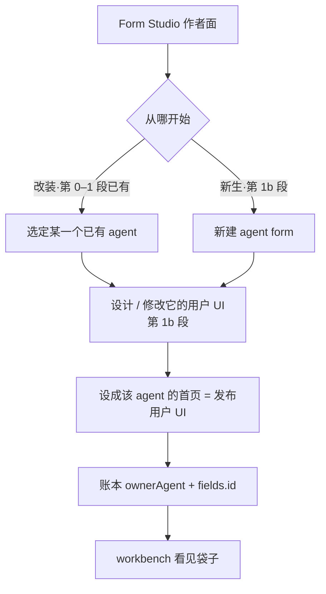
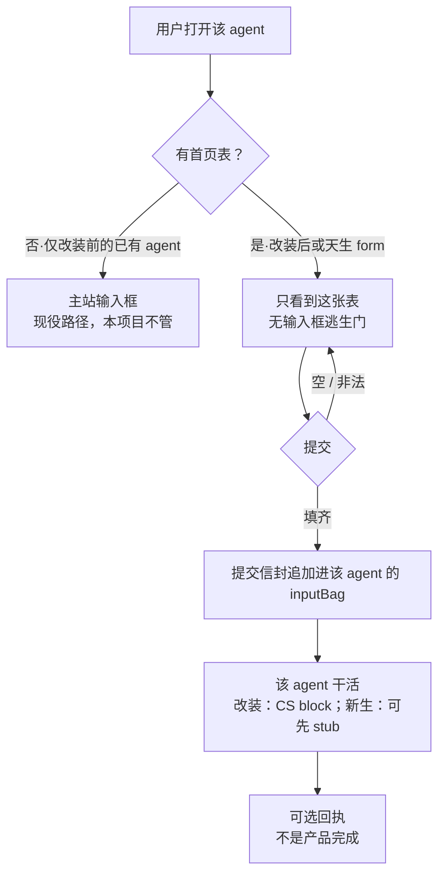
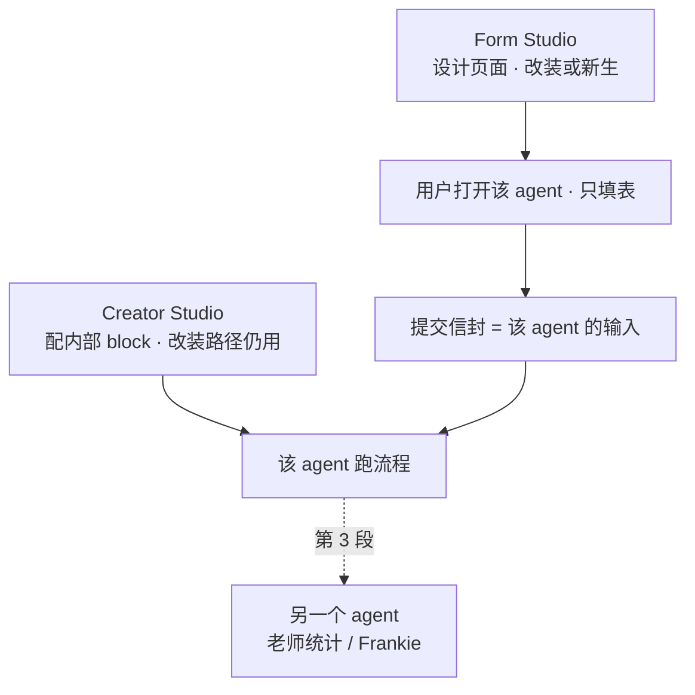

# Form Studio 项目设计

> **版本：** v0.27 · 2026-08-22
> **性质：** 产品方向真相源。仓内不再保留内容重复副本。  
> **来源：** Alan 对日报的定义与应用设想、2026-08-20 复听会议（改页面 / agent form）、2026-08-21 产品边界确认、只读 Poffices Creator Studio（v1.26.1）、2026-08-22 Gravity 表单编辑器截图复核（SurveyJS 系参考实现）。
> **不是：** Poffices agent 配置、发布状态或官方入口的修改工具，也不是外部写权授权令，更不是无主问卷站或任意网站嵌入组件。
> **相对 v0.26：** 明确「设计表达力属核心能力，封闭词表可扩展」；词表新增 `radio` 与固定行列 `grid`（格子展开为 `gridId_rowId_colId` 扁平字段，信封不变），`number` 增加可选小数位。被排除的只是无主问卷、任意嵌入、匿名续填与主题品牌——它们改变表的归属与独占交付合同，不是设计能力。动态行（Dynamic Panel）、Tags、条件 Logic、匿名续填进入延期清单，各自等待业务触发证据。

---

## 0. 仓库用法与工程骨架

`DESIGN.md` 是唯一产品方向真相源；项目入口、架构边界、测试管理和维护方法分别见 `README.md`、`docs/architecture.md`、`docs/testing.md`、`docs/maintenance.md`。本仓仅维护 Form Studio 产品与证据，端口为 4190。

现役骨架：

```
form-studio/
  DESIGN.md                 ← 唯一产品方向真相源
  README.md                 ← 进入项目的索引，不复制产品定义
  contracts/                ← 可机读合同
  data/                     ← 本地 demo 配置、基准种子与被忽略的 SQLite 产品数据
  docs/                     ← 架构、测试与维护指南；不复制产品定义
    plans/                  ← 现役实施计划；完成后回写职责文档并删除
  public/                   ← 作者面和使用面浏览器资产
  src/
    domain/                 ← ownerAgent / 字段 / 提交信封等纯规则
    application/            ← 提交、作者面投影等用例
    infrastructure/         ← 可替换的 mock 仓储
    presentation/           ← 表单 HTML 渲染
    server/                 ← HTTP 与静态文件适配
  tests/
    contract/               ← 账本与渲染合同
    runtime/                ← 校验、信封、inputBag
    e2e/                    ← 改装、新生与作者后台
    fixtures/               ← 手写基准示例；不是作者范式
    support/                ← 跨测试共享夹具
  scripts/                  ← 结构门禁
```

第 0–1b、第 2 段本地旁路、第 3 段的 3A / 3B / 3C 本地切片，以及 v0.27 固定行列设计表达力均已落地。3C 已跑通“学生提交 → 老师查看 → 本地 `AgentInputPort` 收件”，但旧 `agent-access/v1` 和 `submission-record/v1` 仍是课堂合同，由 adapter 兼容，不能据此称为通用消费者产品。**当前不自动建设 AppConnection、第二套业务 UI 或 AI 制表**。下一件先用真实作者任务复核合同一致性、历史版本解释与 fixed grid 的作者安全；消费者 binding / projection 等待第一个真实非课堂消费者证据，Poffices adapter 等待正式输入合同与获授权 sandbox trace。手写基准示例只做回归，不当万用模板。

---

## 1. 一句话

Form Studio 是和 Creator Studio 同一类的作者后台。作者**设计**一张能提交的 web 表，并把它变成某一个 agent 的用户 UI。用户打开该 agent 时只填这张表；校验通过后，字段成为这个 agent 的输入。

**页面 = 该 agent 的用户 UI。** 就是用户点开这个 agent 时先看见的界面。可以这么理解，但不要扩成「本工作室的界面」或「Creator Studio 的框图」。

| 词 | 就是 | 不是 |
|---|---|---|
| 页面 / 用户 UI | 打开该 agent 时的门面 | Form Studio 工作台、Block Diagram |
| 首页表 | 这扇门已经是一张可提交的 form | 作者后台里的账本、袋子 |
| 已发布版本 | 作者明确发布、用户入口当前正在使用的页面版本 | 草稿、万用模板 |
| 设成首页 | 把这张表发布成该 agent 的用户 UI | 在本页用 alert 假装成功 |
| 袋子 | 这个 agent 收到的提交信封 | 用户打开时看到的 UI |

两条出生路径，用户打开时没有区别：

1. **改装：** 某一个已有 agent 的用户 UI 可以改。把它从万能输入框换成这张表。agent 还是那个 agent。  
2. **新生：** 创建一个新的 agent 时，用户 UI 一开始就是 form。**agent form：form 就是一个 agent。** 创建这个 agent 和画出这张表是同一件事。

名字保留 Form Studio。口号是「设计某一个 agent 的用户 UI」。不是 Typeform，也不是从 Creator Studio 的框图里把表读出来。

老师原话（2026-08-19 05:20）：

> The final goal is the form studio is a backend like creator studio that allow developer to design a web form and set to be the front page of the particular agent.

老师复听要点（2026-08-20）：

1. 可以把 agent 的页面给修改。  
2. 能不能在创建一个新的 agent 的时候，就把页面创造成一个 form。agent form，form 就是一个 agent。

---

## 2. 背景：为什么是独立产品

老师要求先做减法。减法后的产品**不是**「更小的网站生成器」，而是 Poffices 里缺的一层：Creator Studio 能配 agent 内部怎么跑，主站打开 agent 时仍是一个万能输入框，块库里没有 form。Form Studio 补的是 agent 的**用户 UI**：格子由作者设计，不是从 Variables / Block Diagram 解析出来。

| | Creator Studio | Form Studio |
|---|---|---|
| 签的合同 | agent 内部怎么跑 | 打开该 agent 时交哪些格子 |
| 用户打开后看到 | （不直接使用作者面） | 该 agent 的表；独占，无输入框逃生门 |
| 完成标志 | agent 能跑 | 打开该 agent 先填表，字段进它的输入袋 |
| 越界症状 | 在 CS 里发明 form block | 先做无主通用表单站；或只读 CS 框图来「生成」表 |

---

## 3. 产品定义

### 3.1 是

- 和 Creator Studio 同一类的**作者面**（不是填表前台）。作者在这里**设计**表，不是只读取一张已写好的夹具。
- 同一套工作室，两条入口：
  - 选某一个已有 agent，**修改它的页面**（改装）。
  - **新建一个 agent form**（新生）。目录里它就是一个 agent；点开就是这张表。
- 表是这个 agent 的**公开输入类型**，也是它的**用户 UI（页面）**。给人填的 schema；账本是机器读的同一份 schema；输入袋是该类型的一次取值。
- 提交 = 校验后把字段交给该 agent。回执页可选，回执不是完成。
- v1 **一表对一 agent**。一个 agent 最多一张首页表。

「form 就是一个 agent」说的是**产品身份 / 目录身份**，不是「HTML 自己去跑模型」。改装路径上，内部 block 仍归 Creator Studio。新生路径上，实现可以先是一个只收信封的 stub；用户打开的那个东西，仍然是这个 form agent。

### 3.2 不是

- 缩小版整站生成器。
- Typeform / 金数据：不为好看做主题市场，不为无主问卷而存在。
- Creator Studio 的替代品；不设计 agent 内部 block 图。
- 从 Overview / Block Diagram / Variables **读取**或自动生成表。Variables 是 prompt 槽（如 `{query}`），不是首页字段。
- 对现有全部 agent 做入口分析并**自动生成**对应表。
- 给库里每一个 agent 都做一张表。多数已有 agent 可以继续用输入框。
- 一张不对应任何可打开 agent 的表（无主）。先画表再「以后找主人」非法；画表即出生这个 agent 合法。
- 配了表之后仍保留输入框当另一种入口。双通道等于两份合同。
- Frankie / 课堂练习本身。那是 Form Studio 做完之后的应用。课堂故事最贴新生路径：老师创建一个练习 agent，做的就是画表。

「不是 Typeform」挡的是**归属与交付合同**，不是**设计表达力**：为某一个 agent 设计更丰富的表单（矩阵、评分等字段语义）是核心能力；被排除的只是无主问卷、任意网站嵌入、匿名续填、主题品牌这些依赖「表没有主人、没有独占交付」的问卷平台语义。参考 SurveyJS 系编辑器时只借字段语义与作者流，不借平台语义。

老师 05:59：*after the form studio is done*，接到 Frankie 的 daily outcome / report summarizer，做成课堂练习（学生在表里答题，老师在自己的 agent 里看统计和标准答案）。应用故事，不是产品身份。

拿到某个 agent 的完整 Block Diagram JSON 后，可以只读分析 block、edge、入口变量、数据流和外部依赖，帮助建立运行时输入映射；它仍不直接决定用户页面栏位。JSON 没有同时给出 block 语义、schema/version、成功输入输出和运行 trace 时，不得声称已完整理解真实运行。

### 3.3 核心能力、用户界面与消费者边界

先固定术语，避免用“有几个页面”代替产品边界判断：

| 术语 | 本文含义 | 当前例子 |
|---|---|---|
| 核心能力（capability） | Form Studio 必须长期负责的产品语义 | 设计/发布用户 UI、渲染/提交、保存和可靠投递提交 |
| 用户界面（surface） | 人直接完成任务的可见界面；一个界面可以承载多项能力 | 作者工作台 `/`、已发布用户页面 `/a/:ownerAgent` |
| 路由（route） | 当前 HTTP 实现入口，不自动等于一个产品或能力 | `/classroom`、`/preview/:ownerAgent` |
| 消费者应用/适配器 | 通过稳定端口读取提交并完成自己的业务任务 | Frankie 课堂；以后可能有 CRM、分析或批处理 |

产品方向确定的边界：

- Form Studio 核心负责造表、发布、收表和把同一份提交可靠交给已声明端口。
- 课堂统计、CRM 工单处理、业务分析等应用专属流程不进入 Form Studio 核心。它们可以有自己的 UI；“应用外置”不是“新应用不准有页面”，而是新应用不应迫使核心新增应用专属角色、scope 字段或页面分支。
- 作者已经明确需要在同一 agent 下核对字段合同、已发布页面和实际提交，因此工作台提供「提交记录」作为 owner-scoped 诊断视图。它不包含课堂评分、CRM 工单、统计大屏或消费者业务状态机。
- 正式身份应由外部认证上下文提供。本地 demo 自动进入作者工作区；旧 `/session` 页面撤下，显式测试身份继续由 API/测试 resolver 提供，不成为产品登录或导航。

当前实现已完成读取端口和组合根两层边界：`agent-access/v1`、`submission-record/v1` 仍保留 `teacher/student/classId/teach` 的课堂含义，但读取 application 已不再解释这些词，由课堂 adapter 映射；`/classroom` 继续调用兼容课堂 API，但只在 demo/test 组合注册。课堂现在是**已从 product 组合隔离的本地参考应用**，仍不能描述成已经验证的多应用消费者产品。

现役形态是一条稳定的读提交能力边界，由外部身份/应用适配为 `principal + capability + resource scope`；版本化合同不得原地改义。课堂和测试 CRM adapter 已分别验证同一端口，但测试探针不是第二个真实应用，也不证明需要连接注册表。

---

## 4. 「表」怎么理解

表是该 agent 的**用户 UI**，也是它的公开输入类型。不拿表去理解或改写 agent 内部怎么跑。

| 问题 | 归谁 |
|---|---|
| agent 内部怎么跑（改装路径） | Creator Studio（Overview / Block Diagram / 变量 / Docs） |
| 用户打开这个 agent 时看到哪张 UI、交哪些格子 | Form Studio 设计的表 |
| 已有 agent 的用户 UI 能不能改 | 能。Form Studio 改装它的首页。 |
| 新 agent 能不能天生是 form | 能。Form Studio 新建 agent form；form 就是这个 agent。 |
| 从框图 / 变量能不能读出该填什么 | 不能。格子由作者定。 |

三件套缺一不可，否则只是网页：

1. **给谁填：** 打开该 agent 的人  
2. **谁在收：** 某一个指定的 agent（`ownerAgent`）  
3. **收什么：** 稳定字段 id，不是一段自由文本，也不是会改的中文标签  

交完去哪已经写在 `submit.to = agent-input`。第 3 段再补「谁能看见提交」；第 1 段 mock 先留下 `submitterId`。

决定表上有哪些栏，等于在定这个 agent 的**入口合同**。字段身份是稳定 `id`，展示文案是 `label`。改标签不等于改 API。

现役 Poffices 入口多半是自由文本（主站输入框 / Input Layer）。格子由作者设计，不是从 block 图里自动读出来。

---

## 5. 要研究和设计的核心

通用的是**工作室**：能设计表，能改已有 agent 的页面，能新建 agent form。不是「全库自动出表」，也不是无主 Typeform。

必须成立：

1. **归属** — 每一张表对应某一个可打开的 agent；打开它时先出这张表。无主则不是本产品。主人可以是已有 id（改装），也可以因这张表而诞生（新生）。  
2. **合同** — 使用面上的栏位必须能被抽出；机器不发明栏位；空提交停在表上；填齐进入该 agent 输入袋。  
3. **作者面是写** — 加栏、改 `id` / `label` / 控件、删栏、预览、发布为该 agent 的页面。从 DOM 抽账本是运行时校验，不是作者工作方式。  
4. **页面独占** — 有表则没有输入框逃生门。

第 0–1 段证明的是**改装路径的合同**：一个已有 mock、一张已写好的夹具、打开先渲染它、提交追加进袋子、能解绑。那是基准示例与挂上，不是作者面完成。作者面完成要能设计；新生路径要能创建 agent form。

产品向量从第一天朝 agent。工程上可以用 mock，不必第一天接真 Poffices。先做无主通用表单站再「以后对接 agent」，会做成另一种通用问卷或站点工具。

第 0 段夹具里就必须有假 `ownerAgent`。不要第 0 段抽无主 `fields[]`，第 1 段再补主人。新生路径同样：表一旦可预览，就必须已经有 agent id。

---

## 6. 主流程

### 6.1 作者面

第 0–1 段（已落地）只走改装、只用手写基准示例，还没有设计面：


第 1b 段才把「设计 / 修改用户 UI」和「新建 agent form」接上。中间预览的永远是**该 agent 的用户 UI**，不是工作台自己。



用户打开时只有一种东西：某一个 agent，它的用户 UI 是这张表。

解绑因出生路径而不同：

- **改装：** 撤掉首页表 → 该 agent 回到无表 → 主站输入框恢复。  
- **新生：** 这个 agent 天生是 form，没有「恢复输入框」。下架 / 解绑 = 该 agent 不再作为可打开的 form 出现（未发布或删除），不假装它有过聊天首页。

v1 不提供「表还在、同时用输入框」。

不是：分析全部已有 agent → 为每一个生成一张表。  
不是：先画一张无主表 → 以后再找一个 agent 来收。

### 6.2 用户面



配了首页表的 agent，表**独占**入口。作者不能给用户留半开的聊天框。

### 6.3 在整条链上的位置



三层同一份合同：作者面定格子，使用面渲染该表，输入袋收下 `values[id]`。

---

## 7. 逻辑对象

### 7.1 字段账本 `form-ledger/v1`

作者保存的是规范化 composite definition；每次发布把它作为不可变快照绑定到 `formVersion`。使用面 HTML 是发布产物，DOM 抽取器负责独立重建并核对同一份账本，而不是运行时真相源。生产 HTML 不嵌入完整 grid JSON。没有 `ownerAgent` 的账本非法；第 0 段基准示例也必须带假 id（例如 `exercise-1`）。

控件上的 `name` = 字段 `id`。`label` 从对应 `<label>` 来。机器不按可见文案当主键。

```json
{
  "version": "form-ledger/v1",
  "ownerAgent": "exercise-1",
  "formVersion": 1,
  "status": "published",
  "fields": [
    { "id": "q1", "label": "题目", "control": "text", "required": true },
    { "id": "a1", "label": "答案", "control": "textarea", "required": true }
  ],
  "submit": { "label": "提交", "to": "agent-input" }
}
```

| 字段 | 规则 |
|---|---|
| `ownerAgent` | 必填。mock 或真实 id。改装 = 已有 id；新生 = 创建时分配的 id。 |
| `formVersion` | 正整数。任何会改变字段解释的 id、label、控件、必填、选项、小数位或 grid 行列变化都递增；提交永远按信封携带的版本读取不可变发布快照。 |
| `status` | `draft` \| `published`。第 1 段夹具视为 `published`。使用面只渲染已发布表。 |
| `fields[].id` | 稳定主键。ASCII / 短 id。控件 `name` 必须等于它。 |
| `fields[].label` | 给人看。可改、可译。不是主键。 |
| `fields[].control` | 封闭枚举，见 7.2。表上控件必须能对上。机器不补栏。 |
| `submit.to` | 必须是 `agent-input`，不是本页切成功页。 |

禁止：用中文标签当 `id`；模型先写账本再「补」表。

`form-ledger/v1` 目前只承诺为 Form Studio **内部 Alpha 合同**：schema 会由真实 Draft 2020-12 validator 执行，但尚无旧外部 consumer 兼容承诺。首次接纳外部 consumer 前必须冻结兼容政策；合同语义改变、既有 consumer 无法无损读取，或信封编码改变，均触发新版本，而不只 Dynamic Panel 才触发。

建议账本或 mock 上另记 `origin`：`retrofit`（改装）\| `born-form`（新生）。用户面不展示；解绑规则靠它。

### 7.2 封闭控件词表

设计表达力属于核心能力，词表可按业务样例扩展；手写 HTML 是基准夹具，作者设计的表必须能映射到本表，不是自由网页。

| `control` | HTML | 说明 |
|---|---|---|
| `text` | `<input type="text">` | 单行 |
| `textarea` | `<textarea>` | 多行 |
| `number` | `<input type="number">` | 非法类型走浏览器校验；可选 `decimals`（小数位，如 `2`）与 `step`，缺省只收整数 |
| `select` | `<select>` | `options[]` 必填 |
| `radio` | `<input type="radio">` | `options[]` 必填；同名字段共享 `name=id` 单选组，信封写入选中项的值字符串；评分是它的一个展示壳 |
| `checkbox` | `<input type="checkbox">` | 值为约定的 on/off，写入信封时布尔或 `"true"`/`"false"`，夹具里写死一种 |
| `grid` | `<fieldset>` + 表格 | **固定**行 × 列 × 标量格，见下方规则 |

`grid` 规则（本拍板）：

- 数据形状不变：每个格子展开为一个普通字段，id 为 `gridId_rowId_colId`（三段各自匹配字段 id 规则），仍平铺进 `values[id]` 信封；格子 id 不得与任何兄弟字段冲突。
- 行列**固定**、由作者定义：行有 `id` / `label`，列有 `id` / `label` / `control` / `required` / `options`；列控件只许用本词表其余控件（text / textarea / number / select / radio / checkbox）；填写者不能增删行。
- 财务矩阵（FY × 指标，列控件为 `number`）与单选矩阵（每行从列选项选一，列控件为 `radio`）是同一 `grid` 的两种列配置。
- 增删行 / 列、改任何行 / 列 `id` 都递增 `formVersion`（等价于改字段 id / 增删栏）；改标签不强制递增。
- 账本里 `grid` 是设计面的一份声明；使用面渲染成真表格后，抽取器必须交叉校验每格 `name`、`type`、`required` 与声明一致并重建同一份声明（渲染 / 抽取同构约束不变）。

不做：`file`、richtext、自由 HTML 块、脚本、为好看而加的无字段装饰控件、填写者增删行（动态行，延期项见第 9 段）。第一版作者面不必拖拽、不必主题；必须能加栏、改栏、删栏、预览、发布。

### 7.3 运行时只做入口

1. `checkValidity()` / `reportValidity()`，只认表上已有的 `required` / `type` / `pattern`。  
2. 按控件 `name`（= `id`）抽出值，封成提交信封，不抽成 `{ name: 中文标签, value }`。  
3. **追加**写入 `ownerAgent` 的 `inputBag`（列表，不是覆盖成单条快照）。  
4. 可选：展示回执。禁止 `alert` / `confirm` 冒充成功。

提交信封（第 0 段成功 walk 就要长这样）：

```json
{
  "ownerAgent": "exercise-1",
  "formVersion": 1,
  "submittedAt": "2026-08-19T14:00:00.000Z",
  "submitterId": "student-mock-1",
  "values": {
    "q1": "第一题",
    "a1": "学生作答"
  }
}
```

| 字段 | 规则 |
|---|---|
| `ownerAgent` | 与账本相同。 |
| `formVersion` | 提交当时的账本版本。旁路以后换成 Input Layer 时，`values[id]` 不用改名。 |
| `submittedAt` | ISO-8601。 |
| `submitterId` | mock 也要有（可假）。第 3 段「谁交的」靠它。 |
| `values` | 键是字段 `id`。缺必填栏不得入袋。 |

`grid` 不改变信封形状：每个格子展开为 `gridId_rowId_colId` 普通字段 id，仍平铺进 `values[id]`；agent 输入映射可按格映射，也可以在 mapper 层聚合，信封本身不改。

### 7.4 mock agent

最少五样：`id`、`name`、`origin`（`retrofit` \| `born-form`）、已绑定的表（或 `null`）、`inputBag`（提交信封列表，追加写）。打开该 id 时：有表则只渲染该表；改装且无表则走「无首页」分支（空白说明，不假装已挂上）；新生且未发布则不可作为使用面打开。

- **改装对象：** 预置有 id 的已有 mock（如 `exercise-1`、`exercise-2`），作者选中后改页面。  
- **新生对象：** 作者在 Form Studio 里创建，分配新 id，页面天生是表。这不是无主问卷，是新 agent。

### 7.5 绑定与解绑

- v1：**1 表 : 1 agent**。一个 agent 最多一张首页表。  
- 改装绑定：选定已有 agent → 设计或挂上表 → 账本 `ownerAgent` 等于该 id → 使用面独占该表。  
- 新生绑定：创建 agent form 时即绑定；id 与表一起出生。  
- 改装解绑：清掉绑定 → `inputBag` 历史仍在 → 再打开回到无表路径（输入框侧以后由主站恢复）。  
- 新生下架：`inputBag` 历史仍在；使用面不再把该 agent 当可填的 form 打开；不恢复输入框。  
- 不做：角色分表、多步表、同一 agent 多张首页。

`status`：草稿只在作者面；用户打开只见表状态为 `published` 的那一张。作者改表时用户不应撞半成品。

反漂移约束：

- 通用渲染器不得在空字段时暗中补示例字段；示例只允许在 fixture 与作者显式点「从例子复制」时出现。
- 改装对象未绑定时可以走空门；新生对象未发布或下架后，使用面不得继续把它作为可打开的 form 返回。
- 作者正在编辑的字段属于 `draft`；只要尚未重新发布，就不得在账本或使用面上标成 `published`。

### 7.6 提交记录、读取能力与当前课堂投影

`submission-record/v1` 是当前提交的物理真相源：独立记录 id、原提交信封、服务端验证的 actor context、tenant / class scope 和接收时间。repository 已能按 `ownerAgent`、actor、scope 和时间查询；原提交信封与 agent 输入投递仍以稳定 `values[id]` 为中心。

但 `v1` 不是已经验证的跨应用通用消费者合同：它枚举 `student/teacher/author` 并要求 `classId`。现役读取 application 已通过注入授权适配器改为主体、能力和具体资源输入，课堂 adapter 仍负责 teacher/class 解释；已经成立的是“通用读取端口 + 课堂范围内默认拒绝的列表/详情投影”，不是“角色与作用域任意参数化的提交台账”。

目标中的通用读取能力必须保持三条边界：消费者不能改写提交或字段定义；核心按主体、能力和具体资源范围授权；课堂 adapter 负责把老师/班级关系映射到该能力。若需要改变 `v1` 含义，必须新增版本或显式兼容转换，不能原地改 schema 后仍称同一合同。

非课堂 CRM 测试探针已验证：新增消费者可以只提供 owner allow-list、`submission:read` 和自己的 account scope 映射，不必修改核心 schema、权限动作、工作台或路由。它只提供结构证据，不是产品 CRM 集成。消费者框架、策略引擎、插件市场和通用提交管理 UI 继续等待真实任务触发。

---

## 8. 已冻结的实现原则

- 字段必须先在表上存在，机器不发明 input。  
- 校验只认 HTML 属性。  
- 提交是点名效果，禁止 alert 冒充成功。  
- 不可变发布 definition 是版本真相源；提交读取不得拿当前草稿或当前发布版解释旧 `formVersion`。
- DOM 抽取是发布一致性 Oracle，不是生产状态恢复手段，也不当模型入场券。
- 账本不是设计稿。
- 手写 HTML 是基准夹具，不是作者范式。作者范式是设计字段，渲染成能被同一套规则抽出的表。
- 自由 HTML 不当产品表面；控件词表保持封闭。
- 发布和停用用户页面都要可回滚；合同内部解除绑定时，历史 `inputBag` 不删除。

---

## 9. 分期

没有「某一个 agent 的页面是这张表」，Form Studio 还没开始。第 0 段不要对外叫已起步。第 0 段已经朝 agent：夹具账本带假 `ownerAgent`，成功记录是提交信封，不是无主 `{ name, value }`。


| 段 | 做什么 | 完成定义 | 不做 |
|---|---|---|---|
| **0 真表** | 手写一张封闭词表内的表。空提交停住。填齐能交。DOM 按 `name=id` 抽字段。夹具账本带假 `ownerAgent`。成功写出提交信封。 | walk 三条绿：空 / 非法类型 / 信封入袋（列表追加） | LLM、工作台、真平台、Frankie、自由 HTML |
| **1 改装挂上** | 预置有 id 的 mock agent。夹具表是它的首页（独占）。提交信封追加进它的 `inputBag`。workbench：选 agent、预览表、看见袋子、能解绑。 | 人能指着说：打开的是 A，填的是 A 的首页，三栏以 id 出现在 A 的袋子里 | 登 Poffices、改官方 agent、全库出表、设计面、新建 agent form |
| **1b 设计 + 新生** | 作者在封闭词表内加栏 / 改栏 / 删栏 / 预览 / 发布。两条入口：改已有 mock 的页面；新建一个 agent form（新 id，天生是表）。抽账本与使用面仍走同一套合同。 | 人能不改夹具 HTML、只在工作台画出一张表并打开该 agent 填它；也能新建一个 form agent 打开就填 | 主题市场、自由 HTML、从 CS 框图生成表、任何 Poffices 写回 |
| **2 真身份** | 作者在 Form Studio 自己的数据域为真实 `ownerAgent` 设计、预览和发布；Poffices 仅提供只读身份参照，用户入口由 Form Studio 管理。提交信封形状不变，使用面只渲染 `published`。 | 指定一个真实存在的 agent，打开 Form Studio 受控用户入口先填表，并能证明 Poffices 对象保持不变 | 修改或发布 Poffices agent、改官方入口、在 CS 发明 form block、Frankie |
| **3 应用** | 学生 agent 收表；Frankie 课堂通过受控读取能力查看提交，并由 `AgentInputPort` 把同一提交交给目标 agent。课堂可以有自己的 UI，但其角色、班级和统计语义不进入 Form Studio 核心。 | 本地故事走通；参考应用只通过稳定端口依赖核心，product/demo 组合可区分 | 把课堂练习或下一应用的角色、scope、页面分支写成 Form Studio 核心定义 |

第 0 段、第 1 段已在本仓落地（分层测试绿）。第 1b 段已落地：每个 agent 自己的字段、工作台加栏、新建 agent form；发布用户页面作为该 agent 的用户 UI。基准夹具只留在 `tests/fixtures/exercise-1` 做第 0 段回归。

基准示例不是万用模板。通用的是工作室、封闭控件词表、账本和提交信封。每一张用户 UI 由作者为某一个 agent 设计。新建时可以空白起栏，或「从例子复制」当起点；复制之后改的是这份表，不是改全库模板。

人判：

| 段 | 必须看到 | 看到也不算过 |
|---|---|---|
| 0 | 空提交被拦；填齐有带 `id` 的提交信封；账本有假 `ownerAgent` | 好看但不能交的 HTML；`name` 仍是中文标签；无主 `{ name, value }` |
| 1 | 表挂在 named agent 上；打开只出表；袋子追加可见；能解绑 | 只有本页回显；agent 只写在注释里；袋子要打开文件才知道；覆盖成单条快照 |
| 1b | 工作台里加出新栏并出现在使用面；能新建 agent form 并打开；改装对象仍能改页面 | 仍在改夹具 HTML 才出栏；新建的是无主表；从 CS 变量列表「生成」了表 |
| 2 | 打开一个真实 agent 的 Form Studio 受控使用入口，先是表，没有输入框；Poffices 对象与官方入口保持不变 | 只在设计预览里假装挂上；表和输入框并存；声称 Form Studio 会修改 Poffices agent 或官方入口 |
| 3 | 学生提交出现在老师侧，能按人、按字段 id 看 | 课堂 UI 很全但表仍无主人；统计按中文标签聚合 |

刻意留给以后的（现在不要证明）：Typeform 级拖拽与主题、全库自动出表、`file` / richtext、多步表、角色分表、Frankie 课堂统计 UI；v0.27 起补充：动态行（Dynamic Panel，填写者增删行）、Tags（一个 id 多值，需先拍板编码）、条件 Logic（显隐 / 跳题，改写必填语义）、匿名续填（save & continue）。Dynamic Panel 是明确的 `form-definition/v2` 候选，但不是唯一触发条件；任何无法在现有 composite definition、leaf ledger 与版本兼容政策内无损表达的语义变化同样触发 v2。每一项都要各自的业务证据。无主问卷、任意网站嵌入、Cookie / 品牌化主题，以及修改 Poffices agent / Creator Studio Input Layer，仍是永久非目标。

**不再**把「作者能设计表」和「新建 agent form」留到以后。那是第 1b 段，是原话和复听会议已经要求的。

### 9.1 阶段方案（第 3 段本地边界已收口）

顺序固定：`1b → 2 → 3`。第 1b、第 2 段当前本地旁路和 3A、3B、3C 本地切片已经完成；3C 已把文档事实、最小读提交能力、product/demo 组合、本地化与测试责任收口。现阶段不自动增加第 4 段或连接框架；第一个真实非课堂消费者到来时，先用其任务证据复审范围。后续若再把 1b、2A、2B、2C、3A 或 3B 写成下一件，视为版本漂移。

#### 第 1b 段：设计面 + 新生（已完成，保留验收基线）

作者面从「挂例子」变成「画这个 agent 的用户 UI」。

工作台：

| 区域 | 做什么 |
|---|---|
| 左 | 已有 agent + **新建 agent form** |
| 顶部 | 当前 agent、来源摘要、草稿/发布状态、明确的线上/编辑版本和发布动作；左侧目录徽标只表达「已发布 / 未发布 / 待发布」，不显示裸 `vN` |
| 输入表单 | 封闭词表内加栏 / 改 `label`·控件 / 删栏；宽屏右侧同步显示只读草稿/发布预览；预览支持 60%–140% 缩放，普通滚轮保持滚动。稳定 `id` 集中在「字段接口信息」中默认只读查看/复制，显式修改只进入草稿 |
| 收到的提交 | 当前 owner 的字段结构和授权提交记录投影；主标识按追加顺序显示「提交 #N」，actor identity 留在授权/审计层；切入时重新读取，外部页面的新提交不会停留在旧快照 |

两层属于同一 `ownerAgent` 工作区，共享草稿、发布版本和提交记录；前端页签不授予新权限。作者预览始终只读，真实提交必须从独立 `/a/:ownerAgent` 页面发生。页签按 [W3C APG Tabs Pattern](https://www.w3.org/WAI/ARIA/apg/patterns/tabs/) 实现；“编辑问题—预览—查看响应”的任务关系也可由 [Google Forms 官方界面说明](https://support.google.com/docs/answer/3527854?hl=en) 交叉验证。

两条入口：

1. **改装：** 选“客户回访记录”这类已有 mock → 修改字段 → 发布用户页面。停用用户页面后入口回空态，历史提交保留。
2. **新生：** 新建时同时得到新 `id` 和一张空表（或从例子复制后改）。form 就是这个 agent。下架不恢复输入框。

存储：每个 agent 自己的字段列表（再渲染成使用面 HTML）。`engine` 必须能从使用面抽出与设计面一致的账本。禁止再写死 `bind → exercise-1 基准示例`。

基准示例去留：`tests/fixtures/exercise-1` 只做第 0 段回归和第 1 段「曾经挂上」的对照。工作台提供「从例子复制」，复制后与夹具文件脱钩。

完成定义（人判 + walk）：

- 在工作台修改“客户回访记录”的字段，发布后打开 `/a/exercise-2` 能填、能入袋。
- 点新建，得到新 id；打开它就是刚画的表，不是无主问卷。  
- “市场分析需求”仍能交、能解绑；信封形状仍是 7.3。

不做：拖拽画布、主题、自由 HTML、从 CS 框图生成、任何 Poffices 写回；也不把作者预览伪装成学生身份提交。

#### 第 2 段：真身份（当前本地旁路范围已完成）

`owner-agent-identity/v1` 只回答「主人是谁」。作者仍在 Form Studio 本地制作表；Poffices 详情不替作者决定栏位。换主人从 mock id 到真实存在的 agent，提交信封形状不变。只读身份足以创建隔离本地副本；Form Studio 不申请也不使用 Poffices 配置写权。

- **改装：** 指定一个真实存在的 Poffices agent id；在 Form Studio 自己的数据域建立一表一主的隔离副本、设计并发布版本。先提供 Form Studio 管理的旁路入口，提交进本地 `inputBag`，`values[id]` 不用改名。不改 Poffices agent 本体、官方入口或 block 图。
- **新生：** 本工作室创建的 agent form 有可打开的真实身份（也可先旁路）。  
- 使用面只渲染 `published`。草稿只在作者面。

本地改装机制完成定义：指着一个真实 `ownerAgent` 说，Form Studio 管理的入口只显示它的 `published` 表，信封进它的本地袋子；Poffices 官方 URL 和 agent 配置不属于该完成定义，也不会被 Form Studio 改变。

永久不做：在 CS 里发明 form block、修改或发布 Poffices agent、替换 Poffices 官方入口。Frankie 仍属于外部应用。

第 2 段仍是一个产品里程碑，不在 `1b → 2 → 3` 之间另插顶层阶段；实施内部按下面顺序收窄风险：

| 切片 | 做什么 | 完成定义 | 不做 |
|---|---|---|---|
| **2A 真实身份只读纳管（已完成）** | 通过 infrastructure 适配器确认一个真实 agent id 存在，并映射为合法 `ownerAgent`；冻结外部身份合同 | 真 id 可读、可显示；不存在 / 无权限明确失败；内部账本和提交信封不因外部字段名改变 | 绑定真实入口、写回官方 agent、扫全库、从 Variables / Block Diagram 出表 |
| **2B-A 作者流整理（已完成）** | 把 2A 身份核对从主侧栏移入「改已有 agent」选择流程；起始页只保留改装 / 新生两条入口；工作区显著显示当前 `ownerAgent`、来源和本地状态 | 五秒内能回答正在改谁、改装还是新生、草稿还是已发布版本；Official 候选不再与本地示例假绑定 | 新控件、Poffices 写入、重做完整视觉系统 |
| **2B-B 本地绑定合同（已完成）** | `owner-agent-binding/v1` 只在本地把一个已核实只读身份与一个 form、一个已发布版本相连；Official 也可建隔离副本 | 无主非法；一表一 agent；绑定、解绑和历史 `inputBag` 可回滚；Poffices 对象零修改 | 用名字当主键、把本地绑定冒充平台授权、认证写回 |
| **2B-C 本地旁路入口（已完成）** | 为已绑定真实身份提供 Form Studio 管理的用户入口；只渲染 `published`，提交信封追加进对应本地 `inputBag` | 草稿不泄漏、无输入框逃生门、信封 `ownerAgent` 与绑定一致、解绑可退 | 冒充 Poffices 官方 URL 已改变、接真实 Input Layer |
| **2C 持久新生身份（已完成）** | 把第 1b 已有的本地新生 id 和旁路入口从内存演示升级为持久事实 | 创建、发布、提交后重启服务：同一 id 和 URL 仍存在、只见已发布版本、历史 `inputBag` 不丢；下架仍不可打开 | 注册 Poffices agent、改官方对象、完整模型运行能力、Frankie |

2B-A / B / C 证明本地改装机制；Poffices 官方入口不属于 Form Studio 的最终验收，仓内不再保留平台入口实施切片。第 1b 已经证明新生的临时 id、发布 URL 和下架语义，2C 不得重复这些测试冒充进展，而要补上跨进程持久性。所有切片共用同一份 `ownerAgent`、封闭控件词表、账本和提交信封合同，不各自发明实现。

**2A 落地证据（2026-08-20）：** Poffices 公开 Store detail 实时返回 `Market Analysis` 的 `id=18`；infrastructure 将它映射成只读 `owner-agent-identity/v1`，其中 `ownerAgent="18"`。401 / 403 / 404 / 上游异常已冻结失败映射。Creator Studio 页面另显示 Key=`marketanalyzer`，但公开响应不含该字段，所以它只作人工交叉核对，不静默替换 `ownerAgent`。该对象是 Official；Form Studio 始终只引用其身份，在本地建立隔离页面，不写回平台。

**2B-A / B / C 落地证据（2026-08-20）：** 起始页只呈现改装 / 新生；身份核对住在改装流内。发布产生可机读 `owner-agent-binding/v1`；使用面和提交端点都校验绑定的主人、表和已发布版本一致后才开放。E2E 证明 Official `Market Analysis / 18` 可创建 `local-shadow-only` 本地页面，sandbox 信封按 `values[id]` 追加进对应本地 `inputBag`。这只证明本地改装机制，不证明 Poffices 官方入口已改变。

**2C 落地证据（2026-08-20）：** 生产服务器通过 `src/infrastructure/sqlite-agent-repository.mjs` 使用本地 SQLite；`persistence.spec.mjs` 证明新生后编辑、发布、再改草稿、提交、关闭并重启服务，仍恢复同一 `ownerAgent`、连续新生 id、草稿 / 已发布版本隔离、旁路 URL、绑定和历史 `inputBag`；下架后再次重启仍不可打开且信封不丢。测试模式继续用内存仓储，reset 不进入生产路由。

**3A 落地证据（2026-08-20）：** `submission-record/v1` 与独立 submission repository 已冻结，历史 `inputBag` 可幂等迁移；请求体伪造 `submitterId` 不再生效，提交只采用服务端 actor context。`agent-access/v1` 以 tenant / class / author / teacher 明确范围并默认拒绝。生产本地演示会话使用 HttpOnly、SameSite=Strict cookie；老师端只列获授权的已发布页面，并按 `ownerAgent`、actor、scope、`values[id]` 查看列表和详情。自动检查 61/61 通过；另用正常本地会话完成一条合成故事：学生一提交“星海科技”，授课老师在同班视图看到同一记录。它证明 3A 本地机制，不证明 Poffices 登录、网络试点或真实 agent 消费。

**3B-A / B / C 落地证据（2026-08-20）：** `agent-input-profile/v1` 与 `agent-input-mapping/v1` 已冻结，显式把某一 `formVersion` 的 `values[id]` 映射为结构化请求；未知字段、版本漂移和错控件类型 fail closed；没有配置时投递状态为 `not_configured`，不猜接口。提交与 outbox event 在同一 SQLite 事务落盘，序列化失败一起回滚；relay 以稳定幂等键投递并记录 pending / delivering / delivered / failed 与尝试次数，回执丢失可重试且目标不重复消费。本地 `AgentInputPort`（内存 + SQLite 双实现）跨重启按幂等键只保留一份输入，回执可追溯到 submission id、原信封与 mapping 版本。自动检查 69/69 通过，另以端到端故事证明学生提交 → 老师查看 → 本地端口收件同链。它证明 3B 本地机制，不证明 Poffices 真实 agent 收到输入。

**v0.27 落地与质检修复证据（2026-08-23）：** `radio`、固定行列 `grid` 与 `number` 可选小数位已落地；格子 id `gridId_rowId_colId` 继续平铺进 `values[id]`。质检后补齐了按 `formVersion` 保存/读取不可变发布定义、真实 JSON Schema 执行、浏览器与服务端一致的 number step 语义、grid 逐格可访问名称、容器内窄屏滚动、格子 ID 逐个复制，以及删到最后一行/列的可见反馈。DOM 抽取器从语义表头和控件独立重建 grid，不再解析生产渲染器埋入的 JSON 副本；找不到旧版本定义时保留原始 ID 并显式警告，不伪造标签或分组。单画布与右侧上下文属性栏收口后，`npm run check` 最终 structure ok + 115/115；390px 实测滚动只发生在 grid 容器，页面无横向溢出。它不证明既往已丢失的历史定义可被追溯恢复，也不改变 3B-P、真实身份与消费者侧条件。

**开发数据与验收身份（2026-08-23）：** 当前页面和提交均被用户确认为可丢弃 mock。`form-studio-mock-catalog/v1` 因而成为 demo/test 唯一内容源；desktop demo 与自动测试只共享 catalog，不共享可写运行库。`datasetRevision` 变化允许在 demo 初始化阶段整体替换 agents、submissions、outbox 与本地投递，同 revision 的 checksum 漂移则拒绝启动；真实数据、product 模式或需保留草稿出现后必须停止破坏性同步。产品版本、运行源码 revision、SQLite schema 版本、dataset revision 与 `ownerAgent + formVersion` 是五个独立身份，前端与视觉证据不得再只写“v0.27”。依据与升级条件见 [`docs/research/version-data-governance-20260823.md`](./docs/research/version-data-governance-20260823.md)。

**当前下一件：** 先用至少两种真实作者任务验证 fixed grid 与普通字段能否安全完成首稿、修改、发布和历史回看；不要预建 AppConnection，也不要只改一句文档就转正 AI 制表。AI 候选建议只在合同与历史解释稳定后立项，并以首稿时间 / 返工量为效果指标，保持逐项接受、修改、拒绝和完全不用。消费者 binding 等待真实非课堂消费者；3B-P 继续等待正式 endpoint、最小认证、schema 与获授权 sandbox trace。

**当前阶段判定：** 作者设计、发布、入口校验、独立提交记录、本地 actor / scope、老师最小消费界面和本地 agent 输入投递机制（outbox → relay → `AgentInputPort`）已经成立，仍属于本地可演示 Alpha。真实身份提供方、跨机器运维和 Poffices 侧 agent 输入投递尚未成立，因此不得称为学生 / 老师可用的联网 MVP，也不得说“真实 agent 已交互”。

**当前问题账本（按阻断顺序）：**

| 状态 | 优先级 | 问题 | 影响 | 归属 / 退出条件 |
|---|---|---|---|---|
| 已解决 | P1 | “新生”“稳定 `ownerAgent`”把内部合同当作者卖点 | 作者误以为会连接或生成 Poffices agent | 主文案已改成实际动作；本地 ID 退到详情；新生不可换主人，只可复制字段设计 |
| 已解决 | P1 | 提交嵌在 agent JSON 的 `inputBag` | 无法可靠按学生、班级、时间查询 | 3A-A 已以独立 submission record / repository 接管；逻辑 `inputBag` 仅作兼容投影 |
| 已解决 | P1 | 客户端可伪造 `submitterId` | 不能证明谁提交 | 3A-B 已改为服务端验证 actor；body 身份被忽略 |
| 已解决 | P1 | 没有班级 / 租户和老师授权 | 可能跨范围读写 | 3A-B 已默认拒绝并逐资源复核 actor / scope |
| 已解决 | P1 | 没有老师查询端口和最小视图 | 数据落盘但课堂故事无法读取 | 3A-C 已完成课堂专用的获授权列表、单条详情、提交者筛选、空态与窄屏；它不是通用消费者端口 |
| 待解决 | P1 | 本地演示身份是内存会话，不是真实平台登录 | 服务重启会话失效；不能用于联网学生 / 老师试点 | 3C-P / 试点前：Alan / Poffices 决定可信身份与班级来源；会话绑定正式认证，仍默认拒绝 |
| 已解决 | P1 | 没有 `agent-input-profile`、mapping、outbox 和 transport | 表单提交尚未进入任何可证明的 agent 输入端口 | 3B-A / B / C 已落地：两份输入合同冻结、提交与 outbox 同事务、幂等 relay、本地 `AgentInputPort` 可审计收件；Poffices 运行时调用另需 sandbox trace |
| 待解决 | P1 | Poffices 真实输入 endpoint、认证、schema 和成功样例缺失 | 无法证明真实 agent 交互，不能安全猜接口 | 3B-P 仅解决既有 agent 的运行时调用；平台或 Alan 提供机器合同 / 作者声明，并在获授权 sandbox 验证，不申请配置写权 |
| 已解决 | P1 | 课堂角色、`classId` 与 `teach` 曾进入核心读取用例 | 第二应用会迫使核心理解课堂语义 | 3C 已抽 `principal + submission:read + resource scope` 端口；课堂关系留在 adapter，旧课堂 `v1` 未原地改义；CRM 测试探针无需修改核心 |
| 待解决 | P2 | 历史记录只保存稳定字段 ID，详情暂以当前已发布 label 投影 | label 改名后，旧记录展示名可能不是提交当时文案 | 设计通用读取 projection 时决定是否保存发布版本字段快照；机器查询仍以 `values[id]` 为准 |
| 已解决 | P2 | 老师视图只有稳定 actor ID，缺可读姓名 | 本地机制可判人但难以人工核对 | 3B 已附带保存并显示本地演示姓名 + 稳定 ID；正式身份目录仍是外部来源，姓名不得成为主键 |
| 已解决 | P2 | demo 身份与 `/classroom` 曾在普通本地组合中无条件注册 | 文档说“非产品”，机器边界却无法证明 | 已显式区分 product/demo/test；product 不注册 demo 页面、profiles 和 teacher API，demo 故事仍可运行 |
| 待解决 | P2 | `node:sqlite` 有实验性警告、无备份恢复演练、无多实例方案 | 本地 Alpha 可用，网络试点运维风险未收口 | 试点前完成备份恢复演练与异机 Git 远端；实测需要多实例时再升级存储 |

#### 第 3 段：应用（3A / 3B / 3C 本地切片已完成）

Frankie 课堂是第一个参考应用：学生打开练习 agent 填表；老师侧通过当前课堂专用查询投影按 `submitterId` 和 `values[id]` 查看提交；需要 agent 处理时，再由明确的 `AgentInputPort` 把同一提交信封投递给对应 agent。课堂可以保留自己的业务 UI，但其角色、班级和统计语义不能成为 Form Studio 核心定义。

第 3 段内部按数据风险拆三刀，不改变顶层 `1b → 2 → 3` 顺序：

1. **3A 提交记录与课堂读取投影（已完成）：** 独立 submission repository 保存原提交信封；服务端 actor / scope、逐资源权限和课堂专用列表/详情可验证。当前仍是单机本地演示，不是通用消费者模型或多用户生产存储。内部顺序为：
   - **3A-A 提交记录（已完成）：** 定义独立记录与 repository，原提交信封原样内嵌；迁移既有 `inputBag` 时不丢、不重复。
   - **3A-B 身份与权限（已完成）：** application 接受服务端验证的 actor / scope，不信任 body 中的用户、角色或租户；未命中规则默认拒绝。
   - **3A-C 老师最小视图（已完成）：** 按 `ownerAgent` + 当前 teacher/class scope 浏览获授权提交列表、单条详情和提交者筛选；没有扩成课堂统计大屏，也不冒充通用提交管理能力。
2. **3B agent 输入投递（已完成）：** 定义 `AgentInputPort`；同一事务保存提交信封与待投递事件，再以幂等 relay 交给受支持 adapter。信封形状不变。内部顺序固定为：
   - **3B-A 输入合同与映射（已完成）：** `agent-input-profile/v1` 明确目标 skill、输入模式和 transport；`agent-input-mapping/v1` 显式把某一 `formVersion` 的 `values[id]` 映射为请求。没有合同就失败，不按名称或 Block Diagram 猜。
   - **3B-B 可靠投递（已完成）：** submission record 与 outbox event 同事务落盘；relay 以稳定幂等键投递，记录 pending / delivered / failed 和尝试次数，不覆盖提交。
   - **3B-C 本地受支持端口（已完成）：** 用可审计的本地 `AgentInputPort` 跑通同一信封的映射与消费，证明机制；它不是 Poffices 真交互。
   - **3B-P Poffices 运行时调用 adapter（条件项）：** 只有正式 endpoint、最小调用认证、请求 / 返回 schema 和获授权 sandbox 成功 trace 齐全才接入并宣布真实 agent 收到输入；它只 invoke / 查询本次 run，不修改 agent 定义、发布状态或官方入口。
3. **3C 参考应用故事与产品边界（已完成）：** 学生用户页面提交、老师视图看见对应记录、目标 agent 从受支持端口收到同一份输入，已有本地 E2E 证据。读取 application 不解释课堂词汇，product 不暴露 demo 身份和课堂入口，非课堂 CRM 测试 adapter 可在不改核心的情况下按 account scope 读取。旧课堂 `v1` 仍由兼容 adapter 使用；测试探针不等同真实第二应用。

真实 agent 交互必须继续分开四个对象：`owner-agent-identity/v1` 回答它是谁；`form-ledger/v1` 回答用户交哪些格子；已落地的 `agent-input-profile/v1` 回答 agent 接受文本还是结构化数据、支持什么 skill 和 transport；已落地的 `agent-input-mapping/v1` 显式把 `values[id]` 映射为运行时请求。后两份合同不得塞进身份合同，也不得靠名字或 Variables 猜出来。

输入能力的证据顺序固定：平台提供的机器合同（Agent Card / OpenAPI / JSON Schema）优先；其次是 agent 作者声明的输入说明与成功样例；最后必须在获授权 sandbox 复核。若 agent 只接受自由文本，可由显式、版本化 mapper 把结构化字段组合成文本，但原提交信封不变。没有 endpoint、认证、请求/返回形状和成功样例，不得宣布已接入真实 agent。

**延期增强：人工为主、AI 为辅。** AI 日后只可在独立建议区提出候选 `label`、控件、必填和稳定 `id`，作者逐项接受后才进入 `fields[]`；不得自动读取 Block Diagram 制表、覆盖既有字段或自动发布。该项不抢占当前 3C 边界收口。

完成定义：一条教学故事能走通；核心读取能力不理解课堂角色/班级；课堂只通过稳定端口依赖核心；product 模式不暴露 demo 身份；至少一个非课堂探针证明无需向核心加入应用专属字段或分支。

不做：把课堂练习写成 Form Studio 的定义；禁止外部应用拥有自己的 UI；建设消费者框架、策略引擎或插件市场；也不在第 3 段才回头补设计面。

---

## 10. 工程约束（新仓）

1. 新身份、新端口。建议 id=`form-studio`，端口 `4190`。  
2. 密钥不落盘。只读观察 Poffices 时不改官方 agent、不点保存。
3. Form Studio 不提供 Poffices agent 配置、发布或官方入口写端口；这不是等待权限的延期项，而是产品边界。3B-P 如实施，只能获得调用既有 agent 和读取本次运行所需的最小权限。
4. 第 0 段成功记录必须是 7.3 的提交信封；禁止再发明一套扁平 `{ name, value }` 再「以后升级」。
5. 作者面产出必须能被账本抽取器读成合法账本。禁止设计面一套字段、使用面另一套 HTML。
6. 第 2 段接触真实身份前必须先有可审计、可回滚的 Git 基线；初始化仓库本身不等于已有远端备份。
7. 测试夹具与 reset 端点不得在真实运行配置中暴露；坏 JSON 应按客户端错误处理，不以 500 冒充服务故障。
8. `ownerAgent`、封闭控件词表、一表一 agent、发布状态和 `formVersion` 等产品规则属于 domain/application；更换 infrastructure 只换 IO，不换语义。
9. 结构门禁要校验真实声明的依赖方向；文件名、行数和文档位置规则是当前拍板项，可按 `docs/maintenance.md` 的变更机制调整，不是假装永恒的产品合同。
10. Poffices 身份读取只服务确认主人和展示上下文；不读取 Variables / Block Diagram 自动制表。有效只读身份（包括 Official）可在 Form Studio 建隔离本地页面；任何 Poffices 配置或入口写回都不进入本产品。

---

## 11. 已收口

v0.1 四问仍有效处保留；第 3 问按 2026-08-20 复听改掉。第 5 问是 v0.2 补收口。第 6 问是 v0.3 补收口。第 7 问在 v0.17 首次提出，由 v0.18 修正绝对化表述，v0.20 确认 owner-scoped 提交诊断进入工作区，v0.21 再收敛为输入表单与收到的提交两层，v0.22 补齐预览缩放和 actor 投影，v0.23 改以 owner 内追加序号作为收件箱主标识，v0.24 把稳定字段 ID 收入不重排主界面的受控接口面板。第 8 问由 v0.26 明确 Poffices 写入不是产品目标。第 9 问由 v0.27 明确设计表达力属核心能力、问卷平台语义不进入产品。

| # | 问题 | 决定 |
|---|---|---|
| 1 | 第 1 段 mock 是否足够 | **mock 足够。** 要证的是归属 + 合同 + 作者面，不是登录写回。第 1b 段仍用 mock。 |
| 2 | 表替换输入框，还是并存 | **对该 agent 独占替换。** 改装前无表则现役输入框（本项目不管）。有表则无逃生门。改装解绑后才恢复输入框。新生 agent form 没有输入框可恢复。 |
| 3 | 只选已有，还是可以新建 | **两条路都合法。** 改装：选已有 agent，改它的页面。新生：设计表时诞生 agent 身份（agent form，form 就是这个 agent）。禁止无主表。禁止「先画表，以后再找主人」。 |
| 4 | 第 2 段旁路还是进 Input Layer | **先旁路。** 前提是提交信封稳定，换管道时 `values[id]` 不用改。 |
| 5 | 作者面是挂夹具，还是设计 | **设计。** 第 0–1 段夹具只证明合同。产品要允许 design a web form。抽账本是运行时，不是作者工作方式。不从 CS 框图 / 变量读取出表。 |
| 6 | 要不要做全库万用模板 | **不做。** 基准示例只是例子。通用的是控件词表、账本、信封、工作室。每个 agent 自己的用户 UI。允许「从例子复制」当起点，复制后与夹具脱钩。 |
| 7 | 读提交的界面（老师视图 / 课堂）是不是 Form Studio 核心 | **课堂业务界面不是；当前 owner 的提交诊断是作者工作区能力。** 工作区可核对字段账本、原始提交和投递状态，但不承担评分、统计、CRM 工单或跨应用连接管理。外部应用仍有自己的 UI，不能迫使核心新增应用专属角色、scope 或页面分支。 |
| 8 | Form Studio 是否要修改 Poffices agent 或替换官方入口 | **不需要，也不做。** Poffices 只读身份用于确认 `ownerAgent`；Form Studio 在自己的数据域管理表单、入口和提交。未来若接真实 agent，只调用既有运行时，不获得配置、发布或入口写权。 |
| 9 | 设计能力与问卷平台边界的区分 | **设计表达力属核心能力。**「不是 Typeform / 不是表单设计器」挡的是归属与交付合同（无主、嵌入、续填、品牌），不挡为某一个 agent 设计更丰富的表单；封闭词表可按业务样例扩展（v0.27 起 `radio`、固定行列 `grid`、`number` 小数位）。参考 SurveyJS 系编辑器只借字段语义与作者流，不借平台语义。 |

若老师日后改第 2 条，只允许改成「解绑才恢复」（改装路径），不允许做成表与输入框同时可交。

---

## 12. 附录：依据摘录

- Alan 05:20：Form Studio = creator studio 式后台，**设计** web form，设成 particular agent 的 front page。  
- Alan 05:59：做完之后可接到 Frankie 的 daily outcome / report summarizer，做成 in-class exercise（学生填表答题，老师 agent 看统计和 model answer）。  
- Alan 复听（2026-08-20）：（1）可以把 agent 的页面给修改；（2）创建新 agent 时可以把页面创造成 form；agent form，form 就是一个 agent。  
- Creator Studio v1.26.1：Agent Workspace 按 Office 选 agent；Overview + Block Diagram；块库无 form；Variables 为 prompt 槽（如 `User_Query` → `{query}`），不是首页字段；主站首页为提示框；Shown 控制是否出现在主站 Agent Master。  
- v0.1 收口（仍成立）：公开输入类型、`id`/`label` 分离、封闭控件词表、提交信封、袋子追加、`submitterId`、1:1 绑定、独占入口。第 1 段工程上证明了改装挂上。  
- v0.2 改口：作者面是设计；出生路径为改装 + 新生；「只选已有、禁止在 Form Studio 新建」作废；「不是表单设计器」不再当口号（挡的是 Typeform / 从 CS 读表，不是挡设计）。  
- 页面 = 该 agent 的用户 UI（打开时看见的界面）。不是 Form Studio 工作台，也不是 Block Diagram。第 0–1 段工作台中间栏预览的就是这份用户 UI。  
- v0.3 收口：手写基准表 = 例子，不是万用模板；下阶段顺序 1b 设计+新生 → 2 真身份 → 3 Frankie 应用。
- Gravity 表单编辑器截图复核（2026-08-22）：工具箱含 Comment / Rating / File / Dynamic Panel / Multiple-Choice Matrix / Tags，设置含 Cookie name / Width mode / Logo in title。它证明「字段表达力」与「问卷平台语义」可以分层：Rating 与固定行列矩阵是设计表达力，进入封闭词表；Cookie / 嵌入 / 品牌改变表归属与独占交付合同，永久排除。
