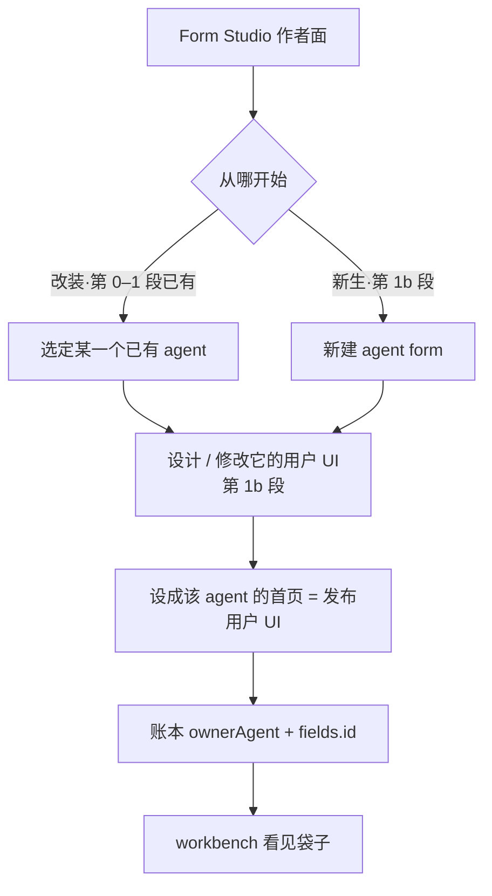
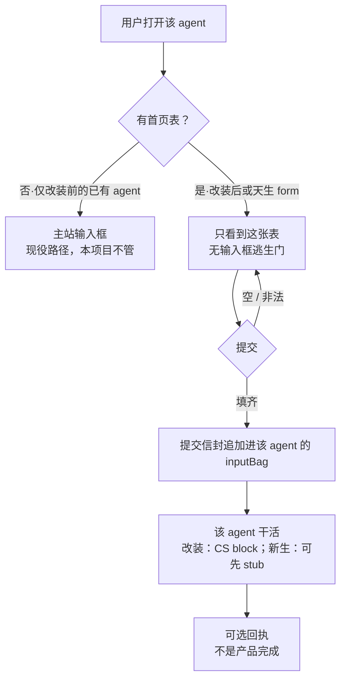
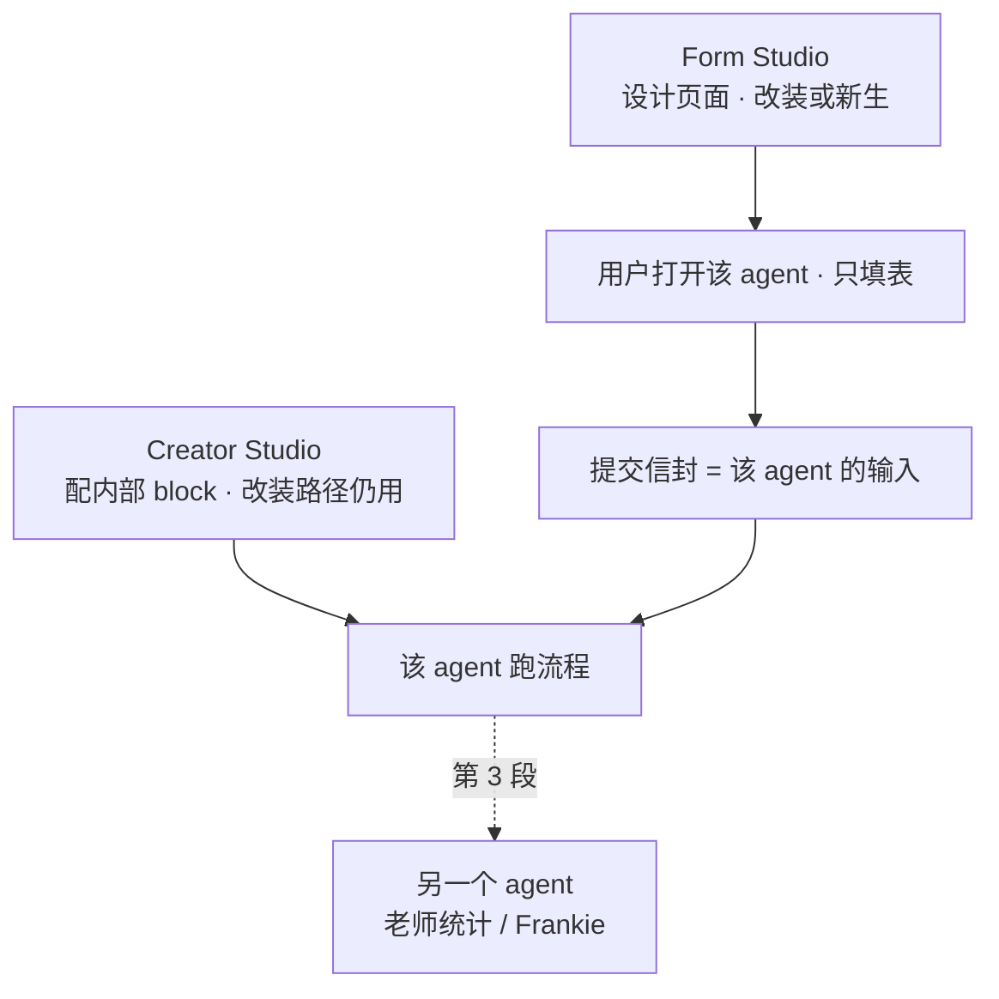

# Form Studio 项目设计

> **版本：** v0.11 · 2026-08-20
> **性质：** 产品方向真相源。仓内不再保留内容重复副本。  
> **来源：** Alan 对日报的定义与应用设想、2026-08-20 复听会议（改页面 / agent form）、只读 Poffices Creator Studio（v1.26.1）。
> **不是：** Poffices 生产改动说明或外部写权授权令。
> **相对 v0.10：** 修正把“Poffices 无写权”误当成“Form Studio 不可创建本地页面”的合同漂移。Official 身份也可建立隔离本地副本；它仍不产生任何 Poffices 写权。宽屏工作区改为设计 / 预览并排，中屏上下分区，小屏单列回流。

---

## 0. 仓库用法与工程骨架

`DESIGN.md` 是唯一产品方向真相源；项目入口、架构边界、测试管理和维护方法分别见 `README.md`、`docs/architecture.md`、`docs/testing.md`、`docs/maintenance.md`。本仓仅维护 Form Studio 产品与证据，端口为 4190。

现役骨架：

```
form-studio/
  DESIGN.md                 ← 唯一产品方向真相源
  README.md                 ← 进入项目的索引，不复制产品定义
  contracts/                ← 可机读合同
  data/                     ← 当前阶段 mock 数据
  docs/                     ← 架构、测试与维护指南；不复制产品定义
  public/                   ← 作者面和使用面浏览器资产
  src/
    domain/                 ← ownerAgent / 字段 / 提交信封等纯规则
    application/            ← 提交、作者面投影等用例
    infrastructure/         ← 可替换的 mock 仓储
    presentation/           ← 表单 HTML 渲染
    server/                 ← HTTP 与静态文件适配
  tests/
    contract/               ← 账本与渲染合同
    runtime/                ← 校验、信封、inputBag
    e2e/                    ← 改装、新生与作者后台
    fixtures/               ← 手写基准示例；不是作者范式
    support/                ← 跨测试共享夹具
  scripts/                  ← 结构门禁
```

第 0–1b、2A 和 2B-A / B / C 已落地：作者能按改装 / 新生进入设计，只读核对真实主人，为真实身份建立隔离的本地页面，并从旁路入口把提交信封追加进 `inputBag`。**当前下一切片是 2C「新生真实身份」**。手写基准示例留在 `tests/fixtures/` 做回归，不当万用模板。

---

## 1. 一句话

Form Studio 是和 Creator Studio 同一类的作者后台。作者**设计**一张能提交的 web 表，并把它变成某一个 agent 的用户 UI。用户打开该 agent 时只填这张表；校验通过后，字段成为这个 agent 的输入。

**页面 = 该 agent 的用户 UI。** 就是用户点开这个 agent 时先看见的界面。可以这么理解，但不要扩成「本工作室的界面」或「Creator Studio 的框图」。

| 词 | 就是 | 不是 |
|---|---|---|
| 页面 / 用户 UI | 打开该 agent 时的门面 | Form Studio 工作台、Block Diagram |
| 首页表 | 这扇门已经是一张可提交的 form | 作者后台里的账本、袋子 |
| 已发布版本 | 作者明确发布、用户入口当前正在使用的页面版本 | 草稿、万用模板 |
| 设成首页 | 把这张表发布成该 agent 的用户 UI | 在本页用 alert 假装成功 |
| 袋子 | 这个 agent 收到的提交信封 | 用户打开时看到的 UI |

两条出生路径，用户打开时没有区别：

1. **改装：** 某一个已有 agent 的用户 UI 可以改。把它从万能输入框换成这张表。agent 还是那个 agent。  
2. **新生：** 创建一个新的 agent 时，用户 UI 一开始就是 form。**agent form：form 就是一个 agent。** 创建这个 agent 和画出这张表是同一件事。

名字保留 Form Studio。口号是「设计某一个 agent 的用户 UI」。不是 Typeform，也不是从 Creator Studio 的框图里把表读出来。

老师原话（2026-08-19 05:20）：

> The final goal is the form studio is a backend like creator studio that allow developer to design a web form and set to be the front page of the particular agent.

老师复听要点（2026-08-20）：

1. 可以把 agent 的页面给修改。  
2. 能不能在创建一个新的 agent 的时候，就把页面创造成一个 form。agent form，form 就是一个 agent。

---

## 2. 背景：为什么是独立产品

老师要求先做减法。减法后的产品**不是**「更小的网站生成器」，而是 Poffices 里缺的一层：Creator Studio 能配 agent 内部怎么跑，主站打开 agent 时仍是一个万能输入框，块库里没有 form。Form Studio 补的是 agent 的**用户 UI**：格子由作者设计，不是从 Variables / Block Diagram 解析出来。

| | Creator Studio | Form Studio |
|---|---|---|
| 签的合同 | agent 内部怎么跑 | 打开该 agent 时交哪些格子 |
| 用户打开后看到 | （不直接使用作者面） | 该 agent 的表；独占，无输入框逃生门 |
| 完成标志 | agent 能跑 | 打开该 agent 先填表，字段进它的输入袋 |
| 越界症状 | 在 CS 里发明 form block | 先做无主通用表单站；或只读 CS 框图来「生成」表 |

---

## 3. 产品定义

### 3.1 是

- 和 Creator Studio 同一类的**作者面**（不是填表前台）。作者在这里**设计**表，不是只读取一张已写好的夹具。
- 同一套工作室，两条入口：
  - 选某一个已有 agent，**修改它的页面**（改装）。
  - **新建一个 agent form**（新生）。目录里它就是一个 agent；点开就是这张表。
- 表是这个 agent 的**公开输入类型**，也是它的**用户 UI（页面）**。给人填的 schema；账本是机器读的同一份 schema；输入袋是该类型的一次取值。
- 提交 = 校验后把字段交给该 agent。回执页可选，回执不是完成。
- v1 **一表对一 agent**。一个 agent 最多一张首页表。

「form 就是一个 agent」说的是**产品身份 / 目录身份**，不是「HTML 自己去跑模型」。改装路径上，内部 block 仍归 Creator Studio。新生路径上，实现可以先是一个只收信封的 stub；用户打开的那个东西，仍然是这个 form agent。

### 3.2 不是

- 缩小版整站生成器。
- Typeform / 金数据：不为好看做主题市场，不为无主问卷而存在。
- Creator Studio 的替代品；不设计 agent 内部 block 图。
- 从 Overview / Block Diagram / Variables **读取**或自动生成表。Variables 是 prompt 槽（如 `{query}`），不是首页字段。
- 对现有全部 agent 做入口分析并**自动生成**对应表。
- 给库里每一个 agent 都做一张表。多数已有 agent 可以继续用输入框。
- 一张不对应任何可打开 agent 的表（无主）。先画表再「以后找主人」非法；画表即出生这个 agent 合法。
- 配了表之后仍保留输入框当另一种入口。双通道等于两份合同。
- Frankie / 课堂练习本身。那是 Form Studio 做完之后的应用。课堂故事最贴新生路径：老师创建一个练习 agent，做的就是画表。

老师 05:59：*after the form studio is done*，接到 Frankie 的 daily outcome / report summarizer，做成课堂练习（学生在表里答题，老师在自己的 agent 里看统计和标准答案）。应用故事，不是产品身份。

---

## 4. 「表」怎么理解

表是该 agent 的**用户 UI**，也是它的公开输入类型。不拿表去理解或改写 agent 内部怎么跑。

| 问题 | 归谁 |
|---|---|
| agent 内部怎么跑（改装路径） | Creator Studio（Overview / Block Diagram / 变量 / Docs） |
| 用户打开这个 agent 时看到哪张 UI、交哪些格子 | Form Studio 设计的表 |
| 已有 agent 的用户 UI 能不能改 | 能。Form Studio 改装它的首页。 |
| 新 agent 能不能天生是 form | 能。Form Studio 新建 agent form；form 就是这个 agent。 |
| 从框图 / 变量能不能读出该填什么 | 不能。格子由作者定。 |

三件套缺一不可，否则只是网页：

1. **给谁填：** 打开该 agent 的人  
2. **谁在收：** 某一个指定的 agent（`ownerAgent`）  
3. **收什么：** 稳定字段 id，不是一段自由文本，也不是会改的中文标签  

交完去哪已经写在 `submit.to = agent-input`。第 3 段再补「谁能看见提交」；第 1 段 mock 先留下 `submitterId`。

决定表上有哪些栏，等于在定这个 agent 的**入口合同**。字段身份是稳定 `id`，展示文案是 `label`。改标签不等于改 API。

现役 Poffices 入口多半是自由文本（主站输入框 / Input Layer）。格子由作者设计，不是从 block 图里自动读出来。

---

## 5. 要研究和设计的核心

通用的是**工作室**：能设计表，能改已有 agent 的页面，能新建 agent form。不是「全库自动出表」，也不是无主 Typeform。

必须成立：

1. **归属** — 每一张表对应某一个可打开的 agent；打开它时先出这张表。无主则不是本产品。主人可以是已有 id（改装），也可以因这张表而诞生（新生）。  
2. **合同** — 使用面上的栏位必须能被抽出；机器不发明栏位；空提交停在表上；填齐进入该 agent 输入袋。  
3. **作者面是写** — 加栏、改 `id` / `label` / 控件、删栏、预览、发布为该 agent 的页面。从 DOM 抽账本是运行时校验，不是作者工作方式。  
4. **页面独占** — 有表则没有输入框逃生门。

第 0–1 段证明的是**改装路径的合同**：一个已有 mock、一张已写好的夹具、打开先渲染它、提交追加进袋子、能解绑。那是基准示例与挂上，不是作者面完成。作者面完成要能设计；新生路径要能创建 agent form。

产品向量从第一天朝 agent。工程上可以用 mock，不必第一天接真 Poffices。先做无主通用表单站再「以后对接 agent」，会做成另一种通用问卷或站点工具。

第 0 段夹具里就必须有假 `ownerAgent`。不要第 0 段抽无主 `fields[]`，第 1 段再补主人。新生路径同样：表一旦可预览，就必须已经有 agent id。

---

## 6. 主流程

### 6.1 作者面

第 0–1 段（已落地）只走改装、只用手写基准示例，还没有设计面：


第 1b 段才把「设计 / 修改用户 UI」和「新建 agent form」接上。中间预览的永远是**该 agent 的用户 UI**，不是工作台自己。



用户打开时只有一种东西：某一个 agent，它的用户 UI 是这张表。

解绑因出生路径而不同：

- **改装：** 撤掉首页表 → 该 agent 回到无表 → 主站输入框恢复。  
- **新生：** 这个 agent 天生是 form，没有「恢复输入框」。下架 / 解绑 = 该 agent 不再作为可打开的 form 出现（未发布或删除），不假装它有过聊天首页。

v1 不提供「表还在、同时用输入框」。

不是：分析全部已有 agent → 为每一个生成一张表。  
不是：先画一张无主表 → 以后再找一个 agent 来收。

### 6.2 用户面



配了首页表的 agent，表**独占**入口。作者不能给用户留半开的聊天框。

### 6.3 在整条链上的位置



三层同一份合同：作者面定格子，使用面渲染该表，输入袋收下 `values[id]`。

---

## 7. 逻辑对象

### 7.1 字段账本 `form-ledger/v1`

机器从**已设计并发布**的页面抽出，模型不先写这份 JSON。作者面编辑的是字段列表（再渲染成表）；抽出的账本必须与页面一致。没有 `ownerAgent` 的账本非法。第 0 段基准示例也必须带假 id（例如 `exercise-1`），抽出的账本从第一天合法。新生的 agent form 在可预览的第一刻就要有 id。

控件上的 `name` = 字段 `id`。`label` 从对应 `<label>` 来。机器不按可见文案当主键。

```json
{
  "version": "form-ledger/v1",
  "ownerAgent": "exercise-1",
  "formVersion": 1,
  "status": "published",
  "fields": [
    { "id": "q1", "label": "题目", "control": "text", "required": true },
    { "id": "a1", "label": "答案", "control": "textarea", "required": true }
  ],
  "submit": { "label": "提交", "to": "agent-input" }
}
```

| 字段 | 规则 |
|---|---|
| `ownerAgent` | 必填。mock 或真实 id。改装 = 已有 id；新生 = 创建时分配的 id。 |
| `formVersion` | 正整数。改字段 id / 增删栏则递增。改 `label` 文案不强制递增。 |
| `status` | `draft` \| `published`。第 1 段夹具视为 `published`。使用面只渲染已发布表。 |
| `fields[].id` | 稳定主键。ASCII / 短 id。控件 `name` 必须等于它。 |
| `fields[].label` | 给人看。可改、可译。不是主键。 |
| `fields[].control` | 封闭枚举，见 7.2。表上控件必须能对上。机器不补栏。 |
| `submit.to` | 必须是 `agent-input`，不是本页切成功页。 |

禁止：用中文标签当 `id`；模型先写账本再「补」表。

建议账本或 mock 上另记 `origin`：`retrofit`（改装）\| `born-form`（新生）。用户面不展示；解绑规则靠它。

### 7.2 封闭控件词表

第 2 段之前只许这些。手写 HTML 是基准夹具；作者设计的表必须能映射到本表，不是自由网页。

| `control` | HTML | 说明 |
|---|---|---|
| `text` | `<input type="text">` | 单行 |
| `textarea` | `<textarea>` | 多行 |
| `number` | `<input type="number">` | 非法类型走浏览器校验 |
| `select` | `<select>` | `options[]` 必填 |
| `checkbox` | `<input type="checkbox">` | 值为约定的 on/off，写入信封时布尔或 `"true"`/`"false"`，夹具里写死一种 |

不做：`file`、richtext、自由 HTML 块、脚本、为好看而加的无字段装饰控件。第一版作者面不必拖拽、不必主题；必须能加栏、改栏、删栏、预览、发布。

### 7.3 运行时只做入口

1. `checkValidity()` / `reportValidity()`，只认表上已有的 `required` / `type` / `pattern`。  
2. 按控件 `name`（= `id`）抽出值，封成提交信封，不抽成 `{ name: 中文标签, value }`。  
3. **追加**写入 `ownerAgent` 的 `inputBag`（列表，不是覆盖成单条快照）。  
4. 可选：展示回执。禁止 `alert` / `confirm` 冒充成功。

提交信封（第 0 段成功 walk 就要长这样）：

```json
{
  "ownerAgent": "exercise-1",
  "formVersion": 1,
  "submittedAt": "2026-08-19T14:00:00.000Z",
  "submitterId": "student-mock-1",
  "values": {
    "q1": "第一题",
    "a1": "学生作答"
  }
}
```

| 字段 | 规则 |
|---|---|
| `ownerAgent` | 与账本相同。 |
| `formVersion` | 提交当时的账本版本。旁路以后换成 Input Layer 时，`values[id]` 不用改名。 |
| `submittedAt` | ISO-8601。 |
| `submitterId` | mock 也要有（可假）。第 3 段「谁交的」靠它。 |
| `values` | 键是字段 `id`。缺必填栏不得入袋。 |

### 7.4 mock agent

最少五样：`id`、`name`、`origin`（`retrofit` \| `born-form`）、已绑定的表（或 `null`）、`inputBag`（提交信封列表，追加写）。打开该 id 时：有表则只渲染该表；改装且无表则走「无首页」分支（空白说明，不假装已挂上）；新生且未发布则不可作为使用面打开。

- **改装对象：** 预置有 id 的已有 mock（如 `exercise-1`、`exercise-2`），作者选中后改页面。  
- **新生对象：** 作者在 Form Studio 里创建，分配新 id，页面天生是表。这不是无主问卷，是新 agent。

### 7.5 绑定与解绑

- v1：**1 表 : 1 agent**。一个 agent 最多一张首页表。  
- 改装绑定：选定已有 agent → 设计或挂上表 → 账本 `ownerAgent` 等于该 id → 使用面独占该表。  
- 新生绑定：创建 agent form 时即绑定；id 与表一起出生。  
- 改装解绑：清掉绑定 → `inputBag` 历史仍在 → 再打开回到无表路径（输入框侧以后由主站恢复）。  
- 新生下架：`inputBag` 历史仍在；使用面不再把该 agent 当可填的 form 打开；不恢复输入框。  
- 不做：角色分表、多步表、同一 agent 多张首页。

`status`：草稿只在作者面；用户打开只见表状态为 `published` 的那一张。作者改表时用户不应撞半成品。

反漂移约束：

- 通用渲染器不得在空字段时暗中补示例字段；示例只允许在 fixture 与作者显式点「从例子复制」时出现。
- 改装对象未绑定时可以走空门；新生对象未发布或下架后，使用面不得继续把它作为可打开的 form 返回。
- 作者正在编辑的字段属于 `draft`；只要尚未重新发布，就不得在账本或使用面上标成 `published`。

---

## 8. 已冻结的实现原则

- 字段必须先在表上存在，机器不发明 input。  
- 校验只认 HTML 属性。  
- 提交是点名效果，禁止 alert 冒充成功。  
- 账本从 DOM 抽，不当模型入场券。  
- 账本不是设计稿。
- 手写 HTML 是基准夹具，不是作者范式。作者范式是设计字段，渲染成能被同一套规则抽出的表。
- 自由 HTML 不当产品表面；控件词表保持封闭。
- 发布和解除本地绑定都要可回滚；历史 `inputBag` 不随解绑删除。

---

## 9. 分期

没有「某一个 agent 的页面是这张表」，Form Studio 还没开始。第 0 段不要对外叫已起步。第 0 段已经朝 agent：夹具账本带假 `ownerAgent`，成功记录是提交信封，不是无主 `{ name, value }`。


| 段 | 做什么 | 完成定义 | 不做 |
|---|---|---|---|
| **0 真表** | 手写一张封闭词表内的表。空提交停住。填齐能交。DOM 按 `name=id` 抽字段。夹具账本带假 `ownerAgent`。成功写出提交信封。 | walk 三条绿：空 / 非法类型 / 信封入袋（列表追加） | LLM、工作台、真平台、Frankie、自由 HTML |
| **1 改装挂上** | 预置有 id 的 mock agent。夹具表是它的首页（独占）。提交信封追加进它的 `inputBag`。workbench：选 agent、预览表、看见袋子、能解绑。 | 人能指着说：打开的是 A，填的是 A 的首页，三栏以 id 出现在 A 的袋子里 | 登 Poffices、改官方 agent、全库出表、设计面、新建 agent form |
| **1b 设计 + 新生** | 作者在封闭词表内加栏 / 改栏 / 删栏 / 预览 / 发布。两条入口：改已有 mock 的页面；新建一个 agent form（新 id，天生是表）。抽账本与使用面仍走同一套合同。 | 人能不改夹具 HTML、只在工作台画出一张表并打开该 agent 填它；也能新建一个 form agent 打开就填 | 主题市场、自由 HTML、从 CS 框图生成表、真 Poffices 写回 |
| **2 真身份** | 作者先在 Form Studio 本地为真实 `ownerAgent` 设计、预览和发布；不改 Poffices agent 本体。改装入口可先旁路，平台官方入口只有在存在正式授权接口时才对接。新生 agent form 也可先旁路。提交信封形状不变，使用面只渲染 `published`。 | 指定一个真实存在的 agent，打开 Form Studio 受控用户入口先填表；若声称 Poffices 官方入口已换门，必须有正式平台授权证据 | 直接修改官方 agent、在 CS 发明 form block、Frankie |
| **3 应用** | 学生 agent 收表；老师 agent 读 `inputBag` 做统计 / 标准答案（Frankie 故事）。靠 `submitterId` 和 `values[id]`。 | 一条教学故事能走通 | 把课堂练习写成 Form Studio 的定义 |

第 0 段、第 1 段已在本仓落地（分层测试绿）。第 1b 段已落地：每个 agent 自己的字段、工作台加栏、新建 agent form；发布用户页面作为该 agent 的用户 UI。基准夹具只留在 `tests/fixtures/exercise-1` 做第 0 段回归。

基准示例不是万用模板。通用的是工作室、封闭控件词表、账本和提交信封。每一张用户 UI 由作者为某一个 agent 设计。新建时可以空白起栏，或「从例子复制」当起点；复制之后改的是这份表，不是改全库模板。

人判：

| 段 | 必须看到 | 看到也不算过 |
|---|---|---|
| 0 | 空提交被拦；填齐有带 `id` 的提交信封；账本有假 `ownerAgent` | 好看但不能交的 HTML；`name` 仍是中文标签；无主 `{ name, value }` |
| 1 | 表挂在 named agent 上；打开只出表；袋子追加可见；能解绑 | 只有本页回显；agent 只写在注释里；袋子要打开文件才知道；覆盖成单条快照 |
| 1b | 工作台里加出新栏并出现在使用面；能新建 agent form 并打开；改装对象仍能改页面 | 仍在改夹具 HTML 才出栏；新建的是无主表；从 CS 变量列表「生成」了表 |
| 2 | 打开一个真实 agent 的 Form Studio 受控使用入口，先是表，没有输入框；官方 Poffices 入口声明另需平台授权证据 | 只在设计预览里假装挂上；表和输入框并存；把本地旁路冒充成 Poffices 官方入口已改变 |
| 3 | 学生提交出现在老师侧，能按人、按字段 id 看 | 课堂 UI 很全但表仍无主人；统计按中文标签聚合 |

刻意留给以后的（现在不要证明）：Typeform 级拖拽与主题、全库自动出表、`file` / richtext、多步表、角色分表、进 Creator Studio Input Layer、Frankie 课堂统计 UI。

**不再**把「作者能设计表」和「新建 agent form」留到以后。那是第 1b 段，是原话和复听会议已经要求的。

### 9.1 阶段方案（当前第 2 段）

顺序固定：`1b → 2 → 3`。第 1b 段已经完成当前人判与 walk，**现在执行第 2 段**；不跳去第 3 段，也不先做 Frankie 课堂 UI。后续若再把「第 1b 段」写成下一件，视为版本漂移。

#### 第 1b 段：设计面 + 新生（已完成，保留验收基线）

作者面从「挂例子」变成「画这个 agent 的用户 UI」。

工作台：

| 区域 | 做什么 |
|---|---|
| 左 | 已有 agent + **新建 agent form** |
| 中 | 预览该 agent 的用户 UI；改装可解绑回空门 |
| 设计条 | 封闭词表内加栏 / 改 `id`·`label`·控件 / 删栏；预览即时反映 |
| 右 | 这份表的入口合同 + 这个 agent 的袋子 |

两条入口：

1. **改装：** 选“客户回访记录”这类已有 mock → 修改字段 → 发布用户页面。解除本地绑定后回空门，袋子保留。
2. **新生：** 新建时同时得到新 `id` 和一张空表（或从例子复制后改）。form 就是这个 agent。下架不恢复输入框。

存储：每个 agent 自己的字段列表（再渲染成使用面 HTML）。`engine` 必须能从使用面抽出与设计面一致的账本。禁止再写死 `bind → exercise-1 基准示例`。

基准示例去留：`tests/fixtures/exercise-1` 只做第 0 段回归和第 1 段「曾经挂上」的对照。工作台提供「从例子复制」，复制后与夹具文件脱钩。

完成定义（人判 + walk）：

- 在工作台修改“客户回访记录”的字段，发布后打开 `/a/exercise-2` 能填、能入袋。
- 点新建，得到新 id；打开它就是刚画的表，不是无主问卷。  
- “市场分析需求”仍能交、能解绑；信封形状仍是 7.3。

不做：拖拽画布、主题、自由 HTML、从 CS 框图生成、真登录写回。

#### 第 2 段：真身份（2B-A / B / C 已落地，下一件 2C）

`owner-agent-identity/v1` 只回答「主人是谁」。作者仍在 Form Studio 本地制作表；Poffices 详情不替作者决定栏位。换主人从 mock id 到真实存在的 agent，提交信封形状不变。身份可读足以创建隔离本地副本；只有写回 Poffices 时才另需平台授权。

- **改装：** 指定一个真实存在的 Poffices agent id；在 Form Studio 自己的数据域建立一表一主的隔离副本、设计并发布版本。先提供 Form Studio 管理的旁路入口，提交进本地 `inputBag`，`values[id]` 不用改名。不改 Poffices agent 本体、官方入口或 block 图。
- **新生：** 本工作室创建的 agent form 有可打开的真实身份（也可先旁路）。  
- 使用面只渲染 `published`。草稿只在作者面。

本地改装机制完成定义：指着一个真实 `ownerAgent` 说，Form Studio 管理的入口只显示它的 `published` 表，信封进它的本地袋子。若最终完成定义要求 Poffices 官方 URL 也直接出表，则必须另有正式入口映射接口与授权证据；旁路不得冒充官方入口已改变。

不做：在 CS 里发明 form block、给全部官方 agent 换门、Frankie。

第 2 段仍是一个产品里程碑，不在 `1b → 2 → 3` 之间另插顶层阶段；实施内部按下面顺序收窄风险：

| 切片 | 做什么 | 完成定义 | 不做 |
|---|---|---|---|
| **2A 真实身份只读纳管（已完成）** | 通过 infrastructure 适配器确认一个真实 agent id 存在，并映射为合法 `ownerAgent`；冻结外部身份合同 | 真 id 可读、可显示；不存在 / 无权限明确失败；内部账本和提交信封不因外部字段名改变 | 绑定真实入口、写回官方 agent、扫全库、从 Variables / Block Diagram 出表 |
| **2B-A 作者流整理（已完成）** | 把 2A 身份核对从主侧栏移入「改已有 agent」选择流程；起始页只保留改装 / 新生两条入口；工作区显著显示当前 `ownerAgent`、来源和本地状态 | 五秒内能回答正在改谁、改装还是新生、草稿还是已发布版本；Official 候选不再与本地示例假绑定 | 新控件、Poffices 写入、重做完整视觉系统 |
| **2B-B 本地绑定合同（已完成）** | `owner-agent-binding/v1` 只在本地把一个已核实只读身份与一个 form、一个已发布版本相连；Official 也可建隔离副本 | 无主非法；一表一 agent；绑定、解绑和历史 `inputBag` 可回滚；Poffices 对象零修改 | 用名字当主键、把本地绑定冒充平台授权、认证写回 |
| **2B-C 本地旁路入口（已完成）** | 为已绑定真实身份提供 Form Studio 管理的用户入口；只渲染 `published`，提交信封追加进对应本地 `inputBag` | 草稿不泄漏、无输入框逃生门、信封 `ownerAgent` 与绑定一致、解绑可退 | 冒充 Poffices 官方 URL 已改变、接真实 Input Layer |
| **2B-P 平台入口（条件项）** | 只有 Poffices 提供正式、可授权、可回滚的入口映射能力时，才把官方用户入口接到已发布版本；仍不改 agent 内部 | 真实 Poffices 入口先见表且可回滚，有平台证据 | 直接改官方 agent、复用浏览器 cookie、无授权探针 |
| **2C 新生真实身份** | Form Studio 创建的 agent form 获得真实或明确旁路的可打开身份 | id 与表一起出生；未发布不可打开；发布后打开只见表；下架不伪装成恢复输入框 | 无主表、完整模型运行能力、Frankie |

2B-A / B / C 证明本地改装机制；若 Poffices 官方入口是最终验收的一部分，2B-P 未通过前不得宣布平台改装完成。2C 再补齐新生路径。所有切片共用同一份 `ownerAgent`、封闭控件词表、账本和提交信封合同，不各自发明实现。

**2A 落地证据（2026-08-20）：** Poffices 公开 Store detail 实时返回 `Market Analysis` 的 `id=18`；infrastructure 将它映射成只读 `owner-agent-identity/v1`，其中 `ownerAgent="18"`。401 / 403 / 404 / 上游异常已冻结失败映射。Creator Studio 页面另显示 Key=`marketanalyzer`，但公开响应不含该字段，所以它只作人工交叉核对，不静默替换 `ownerAgent`。该对象是 Official；这限制平台写回，不阻止 Form Studio 建立隔离本地页面。

**2B-A / B / C 落地证据（2026-08-20）：** 起始页只呈现改装 / 新生；身份核对住在改装流内。发布产生可机读 `owner-agent-binding/v1`；使用面和提交端点都校验绑定的主人、表和已发布版本一致后才开放。E2E 证明 Official `Market Analysis / 18` 可创建 `local-shadow-only` 本地页面，sandbox 信封按 `values[id]` 追加进对应本地 `inputBag`。这只证明本地改装机制，不证明 Poffices 官方入口已改变。

**当前下一件：** 2C 新生真实身份。不是 Poffices 写回，也不是 Frankie。

#### 第 3 段：应用（2 完成后再做）

Frankie 课堂故事：学生打开练习 agent 填表；老师侧按 `submitterId` 和 `values[id]` 看提交与统计；需要 agent 处理时，再由明确的 `AgentInputPort` 把同一提交信封投递给对应 agent。

第 3 段内部按数据风险拆三刀，不改变顶层 `1b → 2 → 3` 顺序：

1. **3A 持久提交与老师视图：** 把当前单进程内存 `inputBag` 换成持久 submission repository；学生身份、班级 / 租户边界和老师查询权限可验证。当前 `inputBag` 只是演示证据，不是多用户生产存储。
2. **3B agent 输入投递：** 定义 `AgentInputPort`；同一事务保存提交信封与待投递事件，再以幂等 relay 交给获官方支持的 Poffices adapter。信封形状不变；没有正式输入合同前只完成本地 port，不伪造真实交互。
3. **3C 课堂故事：** 学生用户页面提交，老师视图看见对应记录，目标 agent 从受支持端口收到同一份输入，一条教学故事端到端走通。

完成定义：一条教学故事能走通。  
不做：把课堂练习写成 Form Studio 的定义；也不在第 3 段才回头补设计面。

---

## 10. 工程约束（新仓）

1. 新身份、新端口。建议 id=`form-studio`，端口 `4190`。  
2. 密钥不落盘。只读观察 Poffices 时不改官方 agent、不点保存。
3. 第 2 段默认仍不依赖 Poffices 登录写回。任何平台入口变更都必须有独立授权、可回滚合同与真实证据；阶段编号本身不授予外部写权限。
4. 第 0 段成功记录必须是 7.3 的提交信封；禁止再发明一套扁平 `{ name, value }` 再「以后升级」。
5. 作者面产出必须能被账本抽取器读成合法账本。禁止设计面一套字段、使用面另一套 HTML。
6. 第 2 段接触真实身份前必须先有可审计、可回滚的 Git 基线；初始化仓库本身不等于已有远端备份。
7. 测试夹具与 reset 端点不得在真实运行配置中暴露；坏 JSON 应按客户端错误处理，不以 500 冒充服务故障。
8. `ownerAgent`、封闭控件词表、一表一 agent、发布状态和 `formVersion` 等产品规则属于 domain/application；更换 infrastructure 只换 IO，不换语义。
9. 结构门禁要校验真实声明的依赖方向；文件名、行数和文档位置规则是当前拍板项，可按 `docs/maintenance.md` 的变更机制调整，不是假装永恒的产品合同。
10. Poffices 身份读取只服务确认主人和展示上下文；不读取 Variables / Block Diagram 自动制表。有效只读身份（包括 Official）可在 Form Studio 建隔离本地页面；任何 Poffices 写回仍须独立的正式授权合同。

---

## 11. 已收口

v0.1 四问仍有效处保留；第 3 问按 2026-08-20 复听改掉。第 5 问是 v0.2 补收口。第 6 问是 v0.3 补收口。

| # | 问题 | 决定 |
|---|---|---|
| 1 | 第 1 段 mock 是否足够 | **mock 足够。** 要证的是归属 + 合同 + 作者面，不是登录写回。第 1b 段仍用 mock。 |
| 2 | 表替换输入框，还是并存 | **对该 agent 独占替换。** 改装前无表则现役输入框（本项目不管）。有表则无逃生门。改装解绑后才恢复输入框。新生 agent form 没有输入框可恢复。 |
| 3 | 只选已有，还是可以新建 | **两条路都合法。** 改装：选已有 agent，改它的页面。新生：设计表时诞生 agent 身份（agent form，form 就是这个 agent）。禁止无主表。禁止「先画表，以后再找主人」。 |
| 4 | 第 2 段旁路还是进 Input Layer | **先旁路。** 前提是提交信封稳定，换管道时 `values[id]` 不用改。 |
| 5 | 作者面是挂夹具，还是设计 | **设计。** 第 0–1 段夹具只证明合同。产品要允许 design a web form。抽账本是运行时，不是作者工作方式。不从 CS 框图 / 变量读取出表。 |
| 6 | 要不要做全库万用模板 | **不做。** 基准示例只是例子。通用的是控件词表、账本、信封、工作室。每个 agent 自己的用户 UI。允许「从例子复制」当起点，复制后与夹具脱钩。 |

若老师日后改第 2 条，只允许改成「解绑才恢复」（改装路径），不允许做成表与输入框同时可交。

---

## 12. 附录：依据摘录

- Alan 05:20：Form Studio = creator studio 式后台，**设计** web form，设成 particular agent 的 front page。  
- Alan 05:59：做完之后可接到 Frankie 的 daily outcome / report summarizer，做成 in-class exercise（学生填表答题，老师 agent 看统计和 model answer）。  
- Alan 复听（2026-08-20）：（1）可以把 agent 的页面给修改；（2）创建新 agent 时可以把页面创造成 form；agent form，form 就是一个 agent。  
- Creator Studio v1.26.1：Agent Workspace 按 Office 选 agent；Overview + Block Diagram；块库无 form；Variables 为 prompt 槽（如 `User_Query` → `{query}`），不是首页字段；主站首页为提示框；Shown 控制是否出现在主站 Agent Master。  
- v0.1 收口（仍成立）：公开输入类型、`id`/`label` 分离、封闭控件词表、提交信封、袋子追加、`submitterId`、1:1 绑定、独占入口。第 1 段工程上证明了改装挂上。  
- v0.2 改口：作者面是设计；出生路径为改装 + 新生；「只选已有、禁止在 Form Studio 新建」作废；「不是表单设计器」不再当口号（挡的是 Typeform / 从 CS 读表，不是挡设计）。  
- 页面 = 该 agent 的用户 UI（打开时看见的界面）。不是 Form Studio 工作台，也不是 Block Diagram。第 0–1 段工作台中间栏预览的就是这份用户 UI。  
- v0.3 收口：手写基准表 = 例子，不是万用模板；下阶段顺序 1b 设计+新生 → 2 真身份 → 3 Frankie 应用。
